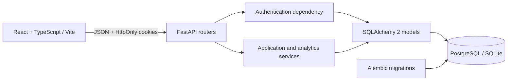
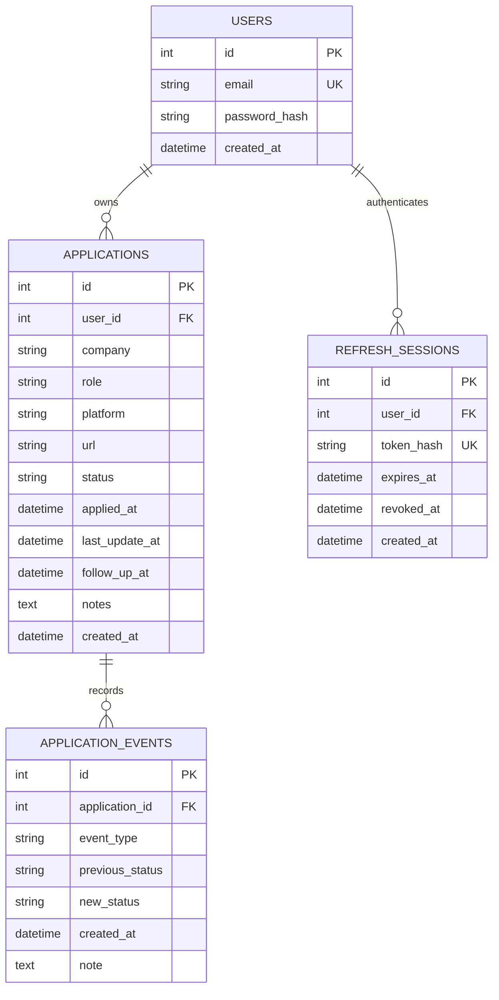
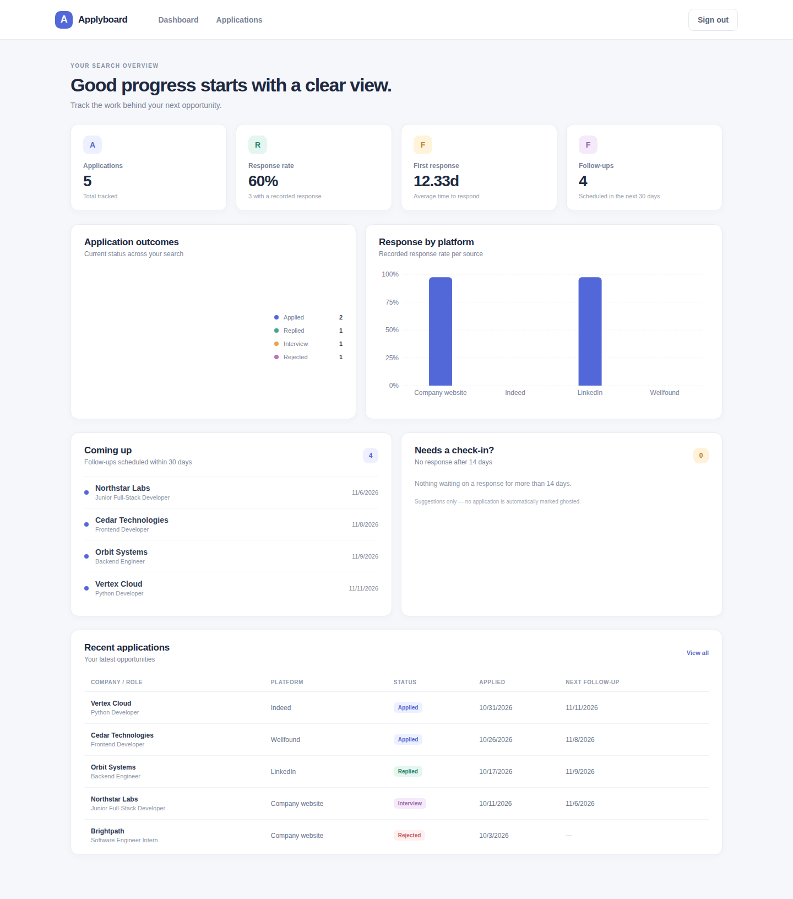
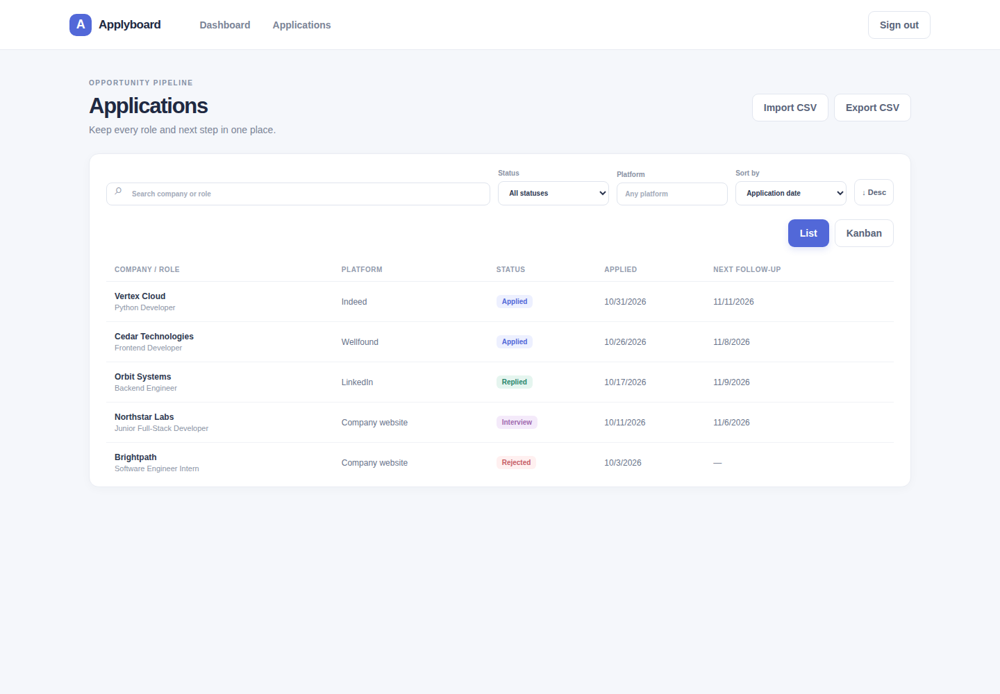
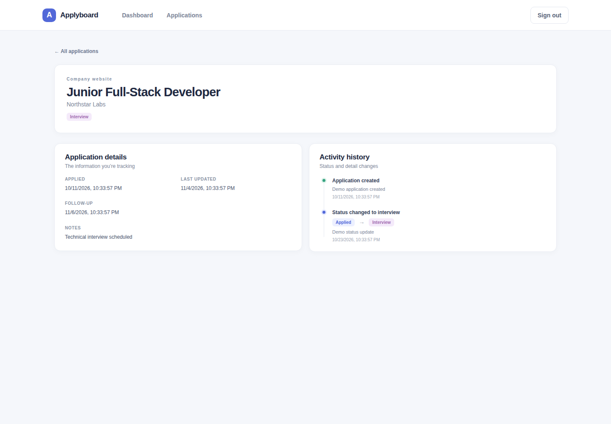

# Applyboard — Job Tracker

Applyboard is a full-stack job-application tracker built as a portfolio project. It helps a job seeker organize applications, record status history, schedule follow-ups, and understand response outcomes without treating each status change as a new application.

## Features

- Argon2 password hashing, HttpOnly access cookies, rotating refresh sessions, and private user-scoped routes.
- One-click, read-only demo workspace with five seeded applications and event history.
- Application create, read, update, and delete with search, platform/status filters, pagination, and sorting.
- Explicit status-transition rules and a chronological event history.
- Dashboard analytics for unique applications, response rates, response time, follow-ups, and possible ghosting.
- Responsive React/TypeScript interface with status/platform charts, application search, history, and a Kanban board.
- CSV import/export for application records.
- Daily email reminders for follow-ups due in the next 24 hours (SMTP configuration required).
- Alembic-managed PostgreSQL schema; SQLite is the zero-setup local default.
- Isolated backend tests with coverage enforcement, Docker Compose, and GitHub Actions.

## Architecture



Backend code separates configuration/security, SQLAlchemy models, Pydantic schemas, route handlers, and reusable services. The frontend keeps API calls and server state separate from pages and shared form/table components.

## Data model



Email is unique. Application ownership is enforced by filtering queries through the authenticated user. Refresh tokens are stored as hashes in `refresh_sessions`, and each refresh token is single-use. Foreign keys cascade deletes from user to applications and refresh sessions, and from application to events. Statuses are constrained to `applied`, `replied`, `interview`, `offer`, `rejected`, and `ghosted`.

## Analytics definitions and business rules

- **Total applications** counts each application record once; status changes never create extra applications.
- A **recorded response** is a status-change event into `replied`, `interview`, `offer`, or `rejected`. A record starting at one of those statuses is not assumed to have a known response date.
- **Response rate** is distinct applications with at least one recorded response divided by all applications; it is represented as a ratio from `0` to `1` (multiply by 100 for percent).
- **Average time to first response** is the mean elapsed time from `applied_at` to the earliest response event. Negative durations are excluded. It is `null` when no valid response times exist.
- Platform metrics use the same unique-application and response-event definitions.
- **Upcoming follow-ups** include scheduled follow-ups from now through 30 days ahead, excluding terminal statuses.
- **May be ghosted** is advisory only: an application still in `applied`, with no recorded response, and an application date at least 14 days old. It is never automatically changed to `ghosted`.
- Status transitions are one-way: `applied` → `replied`, `interview`, `offer`, `rejected`, or `ghosted`; `replied` → `interview`, `offer`, `rejected`, or `ghosted`; `interview` → `offer`, `rejected`, or `ghosted`. `offer`, `rejected`, and `ghosted` are terminal. Repeating the current status is allowed.

## API

OpenAPI/Swagger is available at `http://localhost:8000/docs` while the API is running.

| Method | Path | Access | Purpose |
|---|---|---|---|
| `GET` | `/health` | Public | Liveness check |
| `POST` | `/auth/register` | Public | Create account |
| `POST` | `/auth/login` | Public | Set HttpOnly access and refresh cookies |
| `POST` | `/auth/demo` | Public, rate-limited | Open a read-only sample workspace |
| `POST` | `/auth/refresh` | Refresh cookie | Rotate the refresh session and issue a new access cookie |
| `POST` | `/auth/logout` | Refresh cookie | Revoke the refresh session and clear auth cookies |
| `GET` | `/auth/me` | Auth cookie or bearer token | Read current user |
| `GET` | `/applications` | Auth cookie or bearer token | Search/filter/sort/paginate owned applications |
| `POST` | `/applications` | Auth cookie or bearer token | Create application |
| `GET` | `/applications/{application_id}` | Auth cookie or bearer token | Read owned application |
| `PATCH` | `/applications/{application_id}` | Auth cookie or bearer token | Update owned application |
| `DELETE` | `/applications/{application_id}` | Auth cookie or bearer token | Delete owned application |
| `GET` | `/applications/{application_id}/events` | Auth cookie or bearer token | Read owned application history |
| `GET` | `/stats/summary` | Auth cookie or bearer token | Dashboard metrics and follow-up candidates |
| `GET` | `/stats/platforms` | Auth cookie or bearer token | Per-platform response metrics |
| `GET` | `/stats/responses` | Auth cookie or bearer token | Overall response metrics |

List query parameters are `page` (default `1`), `page_size` (default `20`, maximum `100`), `search`, `status`, `platform`, `sort_by` (`applied_at`, `company`, or `last_update_at`), and `order` (`asc` or `desc`). Invalid request input returns `422`; invalid credentials return `401`; another user’s application is indistinguishable from a missing application (`404`); duplicate email is `409`; invalid status transitions are `409`.

### Example requests

Register and log in:

```powershell
$body = @{ email = "person@example.com"; password = "safe-password-123" } | ConvertTo-Json
Invoke-RestMethod -Method Post -Uri http://localhost:8000/auth/register -ContentType "application/json" -Body $body
$login = Invoke-RestMethod -Method Post -Uri http://localhost:8000/auth/login -ContentType "application/json" -Body $body -SessionVariable session
$headers = @{ Origin = "http://localhost:5173" }
```

Create, list, and inspect analytics:

```powershell
$application = @{
  company = "Example Co"
  role = "Software Engineer"
  platform = "Company website"
  url = "https://example.com/jobs/42"
  follow_up_at = (Get-Date).AddDays(7).ToUniversalTime().ToString("o")
  notes = "Contact recruiter next week"
} | ConvertTo-Json
Invoke-RestMethod -Method Post -Uri http://localhost:8000/applications -Headers $headers -WebSession $session -ContentType "application/json" -Body $application
Invoke-RestMethod -Uri "http://localhost:8000/applications?search=Engineer&page=1&page_size=20" -Headers $headers -WebSession $session
Invoke-RestMethod -Uri http://localhost:8000/stats/summary -Headers $headers -WebSession $session
```

## Local development (Windows PowerShell)

### Backend

Install Python 3.12+, then from the repository root:

```powershell
Set-Location .\backend
py -3.12 -m venv .venv
.\.venv\Scripts\python.exe -m pip install --upgrade pip
.\.venv\Scripts\python.exe -m pip install -r requirements-dev.txt
$env:JWT_SECRET = & .\.venv\Scripts\python.exe -c "import secrets; print(secrets.token_urlsafe(48))"
.\.venv\Scripts\python.exe -m alembic upgrade head
.\.venv\Scripts\python.exe -m uvicorn app.main:app --reload
```

The default database is `sqlite:///./job_tracker.db` relative to `backend`. For PostgreSQL, set `DATABASE_URL` to a URL using the `postgresql+psycopg://` driver. CORS is restricted to the comma-separated origins in `CORS_ALLOWED_ORIGINS` (defaults to `http://localhost:5173,http://localhost:3000`).

### Frontend

In another PowerShell window:

```powershell
Set-Location .\frontend
npm ci
npm run dev
```

Vite serves the frontend at `http://localhost:5173`. Set `VITE_API_BASE_URL` before starting Vite or at build time to configure the API origin.

## Environment variables

| Variable | Required | Description |
|---|---:|---|
| `APP_ENV` | No | Set to `production` to enforce production-only security configuration |\n| `DATABASE_URL` | No for SQLite | SQLAlchemy database URL; defaults to local SQLite |
| `JWT_SECRET` | Yes for login/token use | Random secret of at least 32 bytes |
| `VITE_API_BASE_URL` | Yes | API origin embedded into the frontend build |
| `CORS_ALLOWED_ORIGINS` | No | Comma-separated trusted frontend origins; defaults to `http://localhost:5173` |
| `POSTGRES_USER` | Docker Compose | Local PostgreSQL username |
| `POSTGRES_PASSWORD` | Docker Compose | Local PostgreSQL password; use URL-safe characters |
| `POSTGRES_DB` | Docker Compose | Local PostgreSQL database name |
| `RATE_LIMIT_STORAGE_URI` | Required for multi-worker production | SlowAPI storage URL; configure a shared Redis URL for multiple workers/instances. `memory://` is for local or single-process test use only. |
| `COOKIE_SECURE` | No | Set `true` behind HTTPS; defaults to `false` for local development |
| `SMTP_HOST` | For email reminders | SMTP server hostname |
| `SMTP_PORT` | No | SMTP port; defaults to `587` |
| `SMTP_USERNAME` | For authenticated SMTP | SMTP username |
| `SMTP_PASSWORD` | For authenticated SMTP | SMTP password |
| `SMTP_FROM_EMAIL` | For email reminders | Verified sender email address |
| `SMTP_TIMEOUT_SECONDS` | No | SMTP connection timeout; defaults to `20` |


For production, set `APP_ENV=production` and `COOKIE_SECURE=true`. Set `CORS_ALLOWED_ORIGINS` to exact frontend origins. Configure `RATE_LIMIT_STORAGE_URI` to a shared Redis instance whenever multiple API workers or instances are used; the Render Blueprint requires this value instead of silently defaulting to per-process memory storage. CORS permits only GET, POST, PATCH, DELETE, and OPTIONS, plus Authorization, Content-Type, and X-Requested-With headers. Never commit real credentials or production URLs. Use a unique random JWT secret for each environment. Root `.env.example` contains placeholders for Compose; copy it to `.env`, replace the secret values, and keep `.env` private. For local backend-only development, set `JWT_SECRET` in the PowerShell session before starting Uvicorn.

## Migrations

Models describe the current schema; Alembic revisions are the source of schema changes. Apply migrations with:

```powershell
Set-Location .\backend
.\.venv\Scripts\python.exe -m alembic upgrade head
```

Check for model/migration drift with `.\.venv\Scripts\python.exe -m alembic check`. For a deliberate schema change, update the SQLAlchemy model, generate or author a reviewed revision with `alembic revision --autogenerate -m "describe change"`, inspect the revision, then apply it. Do not use `Base.metadata.create_all()` as a production migration mechanism.

## Tests and coverage

The backend test fixture creates a temporary SQLite database per test and overrides the application database dependency. Tests never connect to the configured development or production database.

```powershell
Set-Location .\backend
.\.venv\Scripts\python.exe -m pytest -q
```

Coverage is measured by `pytest-cov` and enforced at 80% by `pytest.ini`. Backend unit/API tests run against an isolated temporary SQLite database. CI additionally runs dedicated integration tests against its PostgreSQL service after migrations, covering real foreign keys, check/unique constraints, transaction rollback, and concurrent single-use refresh-token consumption. The suite covers authentication, CRUD, validation, ownership, pagination, metrics, follow-up/ghosting rules, event history, CORS, and database constraints. The suite currently contains **49 test functions**, including four PostgreSQL-only integration tests across authentication, CRUD, validation, ownership, pagination, metrics, follow-up/ghosting rules, event history, CORS, and database constraints.

Frontend checks (Vitest covers the API client, application form, and dashboard empty state):

```powershell
Set-Location .\frontend
npm ci
npm run lint
npm run test
npm run build
```

## Docker Compose

Copy `.env.example` to `.env`, replace `POSTGRES_PASSWORD` and `JWT_SECRET`, then from the repository root:

```powershell
Copy-Item .env.example .env
# Edit .env and replace both secret placeholders before starting.
docker compose up --build
```

The Compose stack starts PostgreSQL with a named persistent volume, waits for the database health check, applies Alembic migrations in the API container, and serves the UI at `http://localhost:3000` and API at `http://localhost:8000`. To stop containers without removing data, use `docker compose down`. Removing the named volume destroys local database data; do so only when that is intended.

## Deployment (Render)

The repository includes a `render.yaml` Blueprint for the PostgreSQL database, Docker-based FastAPI service, static frontend, and daily follow-up reminder cron job. Create a new Blueprint from this repository in Render, then provide a shared Redis URL for `RATE_LIMIT_STORAGE_URI` and the SMTP host, username, password, and verified sender address for the cron service. The API will fail closed if production is configured with insecure cookies or process-local rate-limit storage. The API's CORS origin is linked to the deployed static-site host. The blueprint provisions resources; it does not deploy until you connect the repository and approve the Blueprint in your Render account.

## Deployment (manual Render example)

1. Create a managed PostgreSQL instance in Render and keep its internal connection URL private.
2. Create a backend web service from the repository using `backend` as the root directory and its Dockerfile. Set `DATABASE_URL` to the provider URL using the `postgresql+psycopg://` SQLAlchemy driver and generate a unique `JWT_SECRET` with at least 32 random bytes. The backend image applies migrations before starting Uvicorn.
3. Create a Render Static Site using `frontend` as the root directory; build command `npm ci && npm run build`; publish directory `dist`. Set `VITE_API_BASE_URL` to the deployed backend origin and add a rewrite from `/*` to `/index.html` for React Router routes.
4. After connection testing, restrict backend CORS to the exact deployed frontend origin and redeploy.
5. Use HTTPS for both services, enable provider backups for PostgreSQL, and use the platform secret manager for all credentials. Never use local Compose credentials in production.

The API sets short-lived access and rotating refresh tokens in `HttpOnly`, `Secure` (production), `SameSite=Lax` cookies. Refresh-token consumption uses an atomic conditional database update, so only one concurrent request can consume a token and replay of the old token is rejected. Refresh tokens are stored only as SHA-256 hashes, rotated on refresh, and revoked on logout. Cookie-authenticated write requests require an allowed `Origin`; set `COOKIE_SECURE=true` behind HTTPS (the Render Blueprint does this). Bearer authentication remains accepted for existing API clients. The browser client does not read or store either token.

## Vercel backend deployment

Set `APP_ENV=production`, `COOKIE_SECURE=true`, and `RATE_LIMIT_STORAGE_URI` to a shared Redis URL in the backend project's Vercel Environment Variables. Set `DATABASE_URL` to an external PostgreSQL connection string using the `postgresql+psycopg://` driver, and set `JWT_SECRET` to a random value of at least 32 bytes for each deployed environment. The API intentionally refuses to start in production if cookies are insecure or rate limits use per-process `memory://` storage. Keep both values private. Vercel's Python function deployment does not run the Dockerfile command that applies migrations, so run migrations separately against that same database after setting the environment variables locally:

```powershell
Set-Location .\backend
.\.venv\Scripts\python.exe -m pip install -r requirements.txt
.\.venv\Scripts\python.exe -m alembic upgrade head
```

Redeploy the backend after saving environment variables. Check `https://<backend-domain>/health/ready`; a `200` response confirms the database, refresh-session table, and follow-up reminder column are available. A `503` response indicates that `DATABASE_URL` is unreachable or the migrations have not been applied.

[](https://codecov.io/gh/ADAMDEV01/applyboard)

## Screenshots

Use **Try the demo workspace** on the login page to open a seeded, read-only account (`demo@applyboard.dev`). It includes sample application statuses, follow-up dates, and event history; create a personal account to add or change records.

### Dashboard



### Applications



### Application history



## Skills demonstrated

- **Frontend:** React, TypeScript, Vite, responsive UI development, charts, search, and Kanban workflows.
- **Backend:** Python, FastAPI, REST API design, request validation, pagination, filtering, and application workflows.
- **Data:** PostgreSQL, SQLAlchemy, Alembic migrations, relational modeling, and SQLite for zero-setup local development.
- **Security:** Argon2 password hashing, HttpOnly cookies, rotating refresh sessions, per-user authorization, and controlled status transitions.
- **Quality:** pytest, backend coverage enforcement, automated tests, and GitHub Actions CI.
- **Delivery:** Docker Compose, environment-based configuration, and API documentation with OpenAPI.

## Repository

- Source code: https://github.com/ADAMDEV01/applyboard
